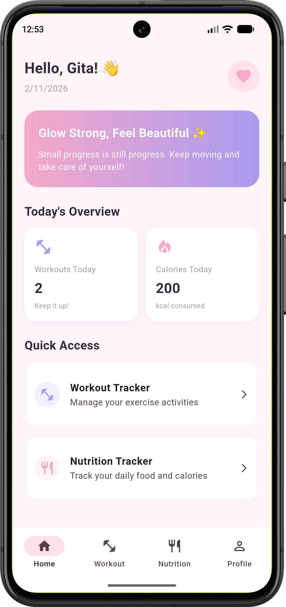
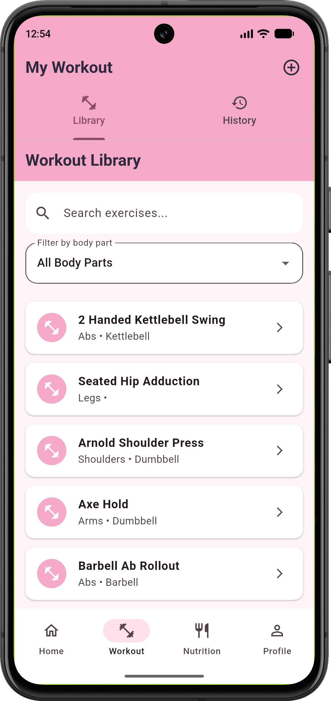
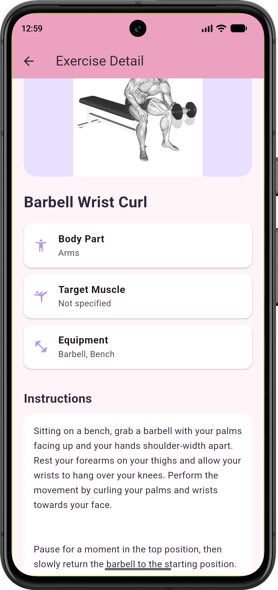
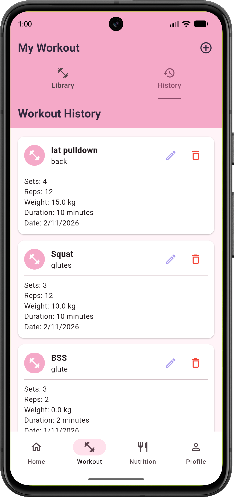
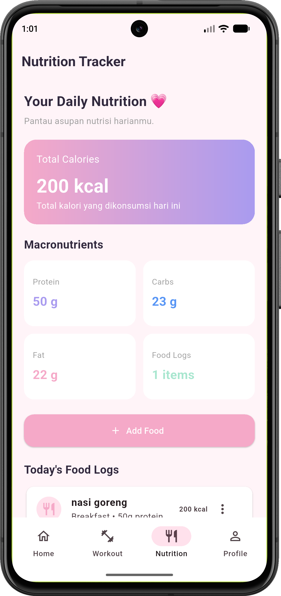
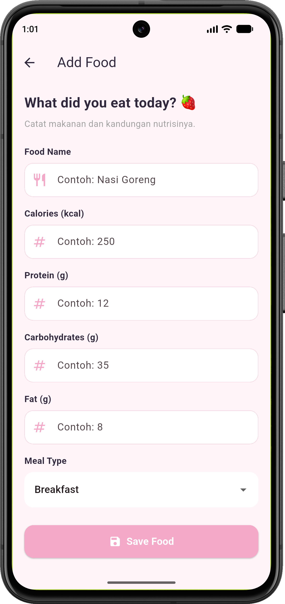
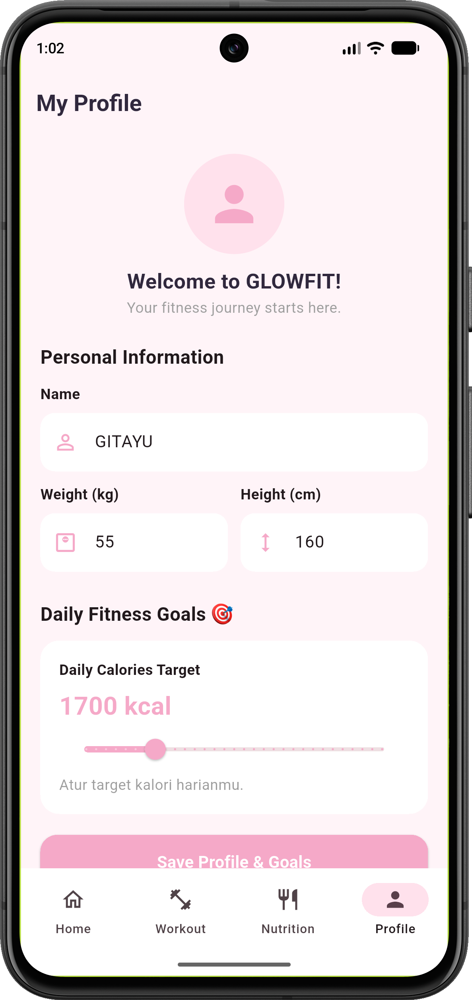

# reptrack

A new Flutter project.

## Getting Started

This project is a starting point for a Flutter application.

A few resources to get you started if this is your first Flutter project:

- [Learn Flutter](https://docs.flutter.dev/get-started/learn-flutter)
- [Write your first Flutter app](https://docs.flutter.dev/get-started/codelab)
- [Flutter learning resources](https://docs.flutter.dev/reference/learning-resources)

For help getting started with Flutter development, view the
[online documentation](https://docs.flutter.dev/), which offers tutorials,
samples, guidance on mobile development, and a full API reference.


# GLOWFIT 💗
## Glow Strong, Feel Beautiful.

GLOWFIT adalah aplikasi mobile berbasis Flutter untuk membantu pengguna mencatat aktivitas workout dan asupan nutrisi harian.

## Fitur Utama

- Home Dashboard: untuk melihat ringkasan aktivitas.
- Workout Library dengan data latihan dari REST API.
- Exercise Detail: untuk melihat informasi latihan.
- Workout History dengan fitur CRUD.
- Nutrition Dashboard: untuk memantau kalori dan makronutrisi.
- Food Log dengan fitur CRUD.
- Profile & Goals: untuk mengatur target nutrisi harian.
- Responsive layout: untuk portrait dan landscape.

## Teknologi

- Flutter
- Dart
- Supabase (Database)
- REST API (dari web wger)
- Provider & ChangeNotifier
- Git dan GitHub

## Arsitektur

GLOWFIT menggunakan pemisahan beberapa lapisan:

UI → Provider → Repository → Service → API/Database

## Struktur Folder

```text
lib/
├── models/
├── providers/
├── repositories/
├── screens/
├── services/
├── theme/
├── widgets/
├── app.dart
└── main.dart
```

## Cara Menjalankan

1. Clone repository.
2. Masuk ke direktori project.
3. Install dependencies:

```bash
flutter pub get
```

4. Konfigurasikan URL dan Publishable Key Supabase pada `lib/main.dart`.
5. Jalankan aplikasi:

```bash
flutter run
```

## Database

GLOWFIT menggunakan Supabase dengan tabel:

- `workouts`
- `food_logs`
- `nutrition_goals`

## Developer

I Gusti Ayu Agung Gita Udiani

Project Ujian Tengah Semester (UTS).

## Tampilan Aplikasi 

### 1. Home Dashboard


### 2. Workout Library


### 3. Exercise Detail


### 4. Workout History


### 5. Nutrition Dashboard


### 6. Food Form


### 7. Profile & Goals 
